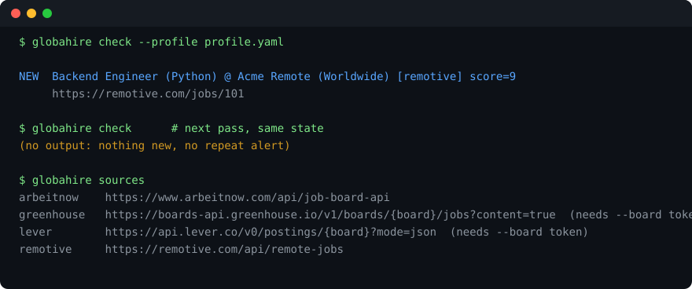

# globahire

**A personal job radar: watch public job boards for roles that match your stack, and get told the moment one drops.** Local, zero dependencies, alerts only.



[](https://github.com/mgkvibez/globahire/actions/workflows/ci.yml)
[](LICENSE)
[](https://pypi.org/project/globahire/)
[](pyproject.toml)
[](https://github.com/mgkvibez/globahire/stargazers)

## Install

```bash
pipx install git+https://github.com/mgkvibez/globahire.git
```

## Three things you can do

```bash
# 1. start a profile, then edit the stack and roles
globahire init

# 2. one pass over the boards; exits 3 when there is something new (cron-friendly)
globahire check --profile profile.yaml

# 3. keep watching every 30 minutes and alert through Telegram as well
export GLOBAHIRE_TELEGRAM_BOT_TOKEN=... GLOBAHIRE_TELEGRAM_CHAT_ID=...
globahire watch --profile profile.yaml --interval 30 --notify terminal,telegram
```

`globahire sources` lists the boards. Greenhouse and Lever need a company token: `--board greenhouse=acme`.

## Why this exists

Job alerts are either too noisy, too late, or behind an account that wants to sell your data. The parts that actually matter are small: a profile you control, a filter that is honest about what it dropped, and a dedupe store so a reposted role does not ping you twice.

Two honest limits, by design:

- **It does not apply for you.** Auto-applying gets accounts banned, and a wrong application sent at machine speed is worse than a missed one. Drafting assistance is V0.2; application queues only for boards with real APIs are V0.3.
- **No logged-in scraping.** LinkedIn and Indeed are not supported, because scraping them breaks their terms and your account. Supported boards are public JSON endpoints.

## How it works

`profile.yaml` is parsed by a deliberately small reader that understands top-level keys, scalars, inline lists and block lists, and **refuses what it does not understand** rather than silently dropping a filter, because a dropped filter means missed jobs.

Matching runs filters first (remote-only, exclusions, locations), then scores: a stack hit is 2 points, a role hit is 3, and a job needs `min_match` (default 1) to count. Every match carries its reasons, so a false positive is easy to explain.

Dedupe is a stable hash of company + title + location, stored in `.globahire/seen.json` and written atomically. Same role on two boards announces once; a repost tomorrow announces zero times.

Exit codes are a contract: `0` nothing new, `3` new matches, `2` something you must fix (bad profile, unknown board, missing credential).

## Contributing

Issues and PRs are welcome. Run `bash scripts/verify.sh` before pushing; it is the same gate CI runs. New boards are a parser function plus a fixture: no network in tests, ever.

## License

MIT
